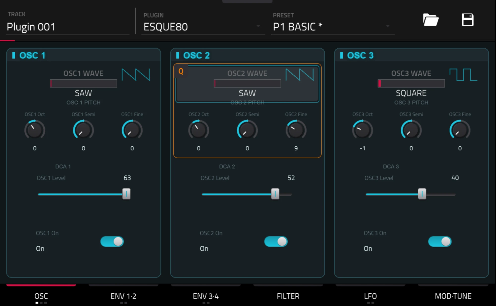

# ESQUE80



A cross-wave synthesizer for Akai MPC standalone hardware, modelled on the architecture of
the Ensoniq SQ-80: 8 voices, 3 wavetable oscillators per voice, a 4-pole low-pass filter,
4 envelopes, 3 LFOs and a 15-source modulation matrix.

ESQUE80 is an independent hobby project. It is not affiliated with, endorsed by or
supported by Ensoniq, E-MU, Creative Technology, Akai Professional or inMusic. All product
names are the property of their owners and are used only to describe what this plugin models.

## What you need

- A standalone MPC running **MPC OS 3.10.1 or later**.
- On the MPC: Preferences → Enhancements (Beta) → **Enable Enhancements** and
  **External Plugin Support**.

## Install

1. Unzip. You get a folder named `Lichthaus - VST - ESQUE80`.
2. Copy that folder into a folder named `VST2 Plugins` at the top level of a drive the MPC
   can run plugins from (the internal drive, or an SSD).
3. Restart the MPC. ESQUE80 appears under External Plugins.

Users of the Open MPC Plugin Manager can install it from the catalogue instead.

## Out of the box: stand-in waves

**This download contains no Ensoniq wave data.** Without it, ESQUE80 builds 75 stand-in
waves at start-up and offers 6 built-in presets plus 40 empty user slots. It plays and
every control works, but the stand-in waves are approximations, so it will not sound like
the original instrument.

## Adding the original wave data (optional)

The original 256 KB wave ROM, its wave table and the factory sound banks belong to their
copyright holders and are not distributed with ESQUE80. If you have a lawful source for
them, put these files in the plugin's `Content/sq80/` folder:

| File | What it is |
| --- | --- |
| `wave0.bin`, `wave1.bin`, `wave2.bin`, `wave3.bin` | the wave ROM, 64 KB each |
| `waves.txt` | the wave table (which samples each wave uses across the keyboard) |
| `bankD.pcb` | optional: 40 factory programs as 102-byte program blocks |
| `bankC.pcb` | optional: up to 128 more programs in the same format |

`tools/sq8l_to_card.py`, in the source repository (github.com/lichthaus/mpc-vst-esque80), writes exactly these files from a local checkout of the
SQ8L sources:

```
python3 tools/sq8l_to_card.py <path to your SQ8L checkout> <output folder>
```

Copy the `sq80` folder it creates into `Lichthaus - VST - ESQUE80/Content/`, replacing the
empty one, then restart the MPC. With the banks present, the programs appear in the MPC's
preset list (P = built-in, D and C = banks, U = user slots).

Please do not redistribute those files with the plugin.

## The panel

Six function keys; press a key again to reach its sub-pages.

| Key | Pages |
| --- | --- |
| OSC | oscillators · OSC MOD (pitch mod routes) · DCA MOD (level mod routes) |
| ENV 1·2 | envelopes 1 and 2 · VEL 1·2 (velocity and keyboard scaling) |
| ENV 3·4 | envelopes 3 and 4 · VEL 3·4 |
| FILTER | cutoff, resonance, tracking, cutoff mod routes, glide |
| LFO | the three LFOs · LFO MOD (depth mod source, final level, reset, humanize) |
| MOD·TUNE | volume, program, pan and pan mod, voice switches |

- Mod sources and LFO waves are tap grids: tap a cell to pick it. The Q-Link knobs and the
  data wheel step through the same choices.
- The envelope displays are live and can be dragged. They show timing accurately; the first
  level (L1) is not drawn, and negative levels sit below mid-height.
- Each Q-Link bank of four follows one panel or block on screen.

## Known limits

- Developed and tested on one device, an **MPC Key 37 (Gen 2)**. The 32-bit ARM build is
  included but has not been run on hardware.
- The stand-in waves are approximate (see above).
- Split and layer settings in imported programs are ignored.
- The MPC keeps decoded panel artwork in memory until it is powered off; restarting the MPC
  app many times without a full power cycle can run it low on memory. This affects all
  plugins with custom panels.

## Download

Releases: https://github.com/lichthaus/mpc-vst-esque80/releases

- `ESQUE80-0.9.0-mpc-sdk.zip`: one folder for any MPC on MPC OS 3.10.1 or later. Copy it into `VST2 Plugins`.
- `ESQUE80-0.9.0-mpc-aarch64.zip` and `ESQUE80-0.9.0-mpc-armv7.zip`: the Open MPC catalogue's per-device packages,
  for its Plugin Manager and installers.

Tested on an MPC Key 37 (Gen 2). The 32-bit (armv7) build has not been run on hardware.

## Building from source

ESQUE80 is built with inMusic's MPC Plugin Builder SDK
(https://github.com/inmusic-software/mpc-plugin-builder-sdk).

```
git clone https://github.com/inmusic-software/mpc-plugin-builder-sdk
git clone https://github.com/lichthaus/mpc-vst-esque80 mpc-plugin-builder-sdk/plugins/ESQUE80
cd mpc-plugin-builder-sdk
python3 tools/build.py plugins/ESQUE80
```

The result is `plugins/ESQUE80/build/Lichthaus - VST - ESQUE80/`. The panel in `skins/` is generated by
`tools/make_skin.py` (needs Pillow, the SDK's cyan film-strip kit and `build/params.json` from a first build);
its header comment lists the paths it expects.

## Licence

ESQUE80 is released under the MIT licence (`LICENSE.txt`). It includes code under other
licences; see `THIRD_PARTY.txt`.
